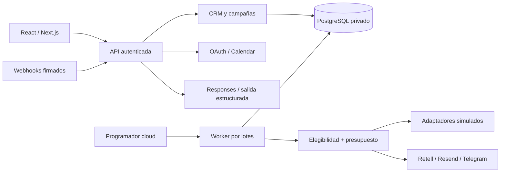

# Arquitectura

## Flujo

Navegador → Next.js Route Handlers → sesión / origen / Zod → servicios comerciales → PostgreSQL. Los trabajos autorizados pasan por `automation_jobs` y por reservas en `operations` antes de llegar a un proveedor.

## Componentes

- `src/components`: interfaz por módulo. Formularios, tablas, paneles y diálogos compartidos.
- `src/lib/domain.ts`: contratos TypeScript y validaciones de entrada.
- `src/lib/db.ts`: una interfaz SQL y transacciones para PGlite local y `postgres` en cloud. Migraciones con historial; cloud las aplica explícitamente antes de servir tráfico.
- `src/lib/security.ts`: sesiones, hashes, HMAC, cifrado AES-256-GCM, rate limiting persistido, control de origen y protección CSV.
- `src/lib/services`: CRM, política de contacto, ventas, cola y webhooks.
- `src/lib/providers`: contratos específicos de cada proveedor. En demo no se inicializan llamadas de red.
- `supabase/migrations`: esquema relacional privado, restricciones, índices y RLS.

## Datos

`companies` y `contacts` representan empresa y contacto corporativo; `prospects` guarda el estado comercial. `products` y `scripts` definen el contexto autorizado. `campaigns` y `campaign_prospects` son la lista y límites de campaña. `calls`, `emails` y `meetings` guardan resultados. `activities`, `audit_logs`, `consent_history` y `webhook_events` aportan trazabilidad. `operations` reserva costos e intentos; `automation_jobs` guarda trabajo duradero. `scheduled_searches`, `notifications`, `integrations`, `settings`, `users`, `sessions`, `rate_limits` y `suppression_list` completan el esquema.

Ninguna tabla comercial tiene acceso de `public`, `anon` o `authenticated`. El acceso se hace por el backend y una conexión privada PostgreSQL. Las tablas tienen RLS sin políticas de acceso cliente: un cliente de Supabase no es el medio de acceder a ellas. La conexión del servidor debe usar el rol propietario del esquema o un rol backend explícitamente autorizado; no una clave de navegador.

## Decisiones

- Administrador único con autenticación propia; no registro público, organizaciones ni facturación.
- PGlite permite una demo SQL persistente sin Docker ni credenciales. No se usa como base cloud ni desde varios procesos.
- `DATABASE_URL` conecta PostgreSQL/Supabase con SQL parametrizado, TLS requerido en producción y prepared statements deshabilitados para el pooler.
- Cola en PostgreSQL para no agregar otro servicio de pago. Un programador cloud realiza invocaciones cortas; no hay dependencia de la Mac.
- El modo del prospecto, campaña, correo, llamada y trabajo es inmutable. Cambiar la preferencia no convierte datos ficticios en reales.
- Cada intento tiene clave única y reserva serializada mediante bloqueo de settings. El worker reclama trabajos con `FOR UPDATE SKIP LOCKED`.
- Un proceso interrumpido durante contacto queda `uncertain`. Reenviar es más peligroso que pedir revisión; no hay garantía ficticia de entrega exactamente una vez en la red externa.
- Los recordatorios preparan tareas humanas; no convierten un seguimiento en permiso para contactar.
- Retell recibe `sales_context`. El agente del proveedor debe incorporar esa variable, idioma y análisis estructurado; ver guía de llamadas.
- Google Calendar usa un ID de evento estable por reunión y consulta disponibilidad antes de insertar. No envía invitaciones automáticamente (`sendUpdates=none`).

## Límites operativos

Un worker ejecuta hasta 10 trabajos por petición y deja de reclamar al llegar a 30 segundos para reservar tiempo al último proveedor (timeout de 20 s). El scheduler debe invocarlo de nuevo para drenar la cola. La recuperación de bloqueos ocurre después de cinco minutos. Si el proveedor aceptó una acción justo antes de una parada de emergencia, esa acción puede continuar; la parada bloquea nuevos intentos.

La API de estado carga el conjunto del modo actual para un administrador y limita actividad y trabajos recientes. Para carteras grandes, añadir paginación de prospectos y endpoints por módulo antes de ampliar volumen. DENUE devuelve lotes de 50; los filtros de texto se aplican a cada lote y no representan una búsqueda nacional exhaustiva.
